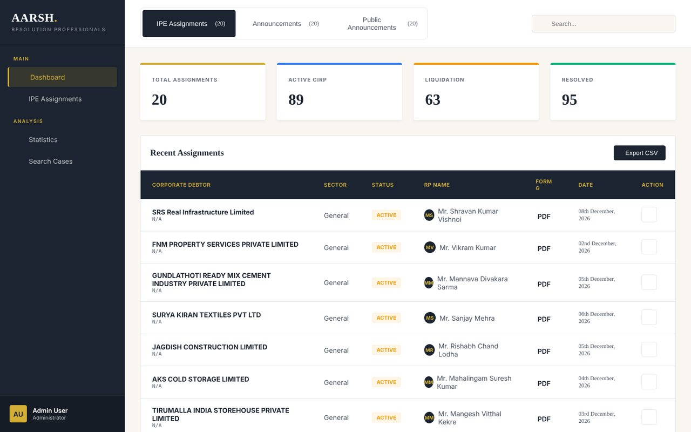
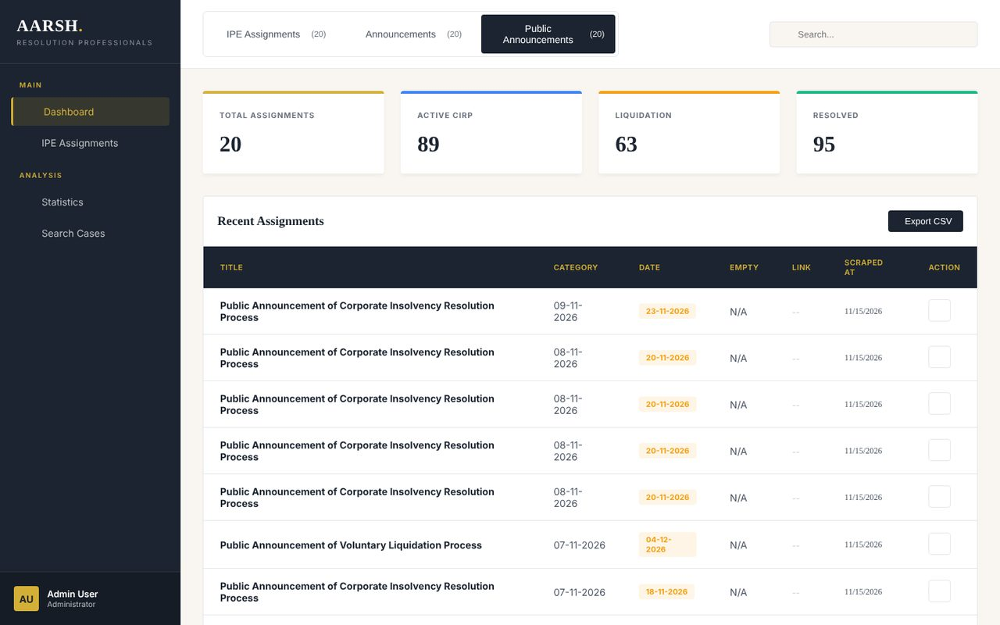
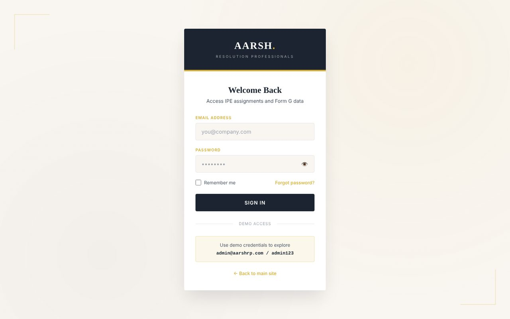
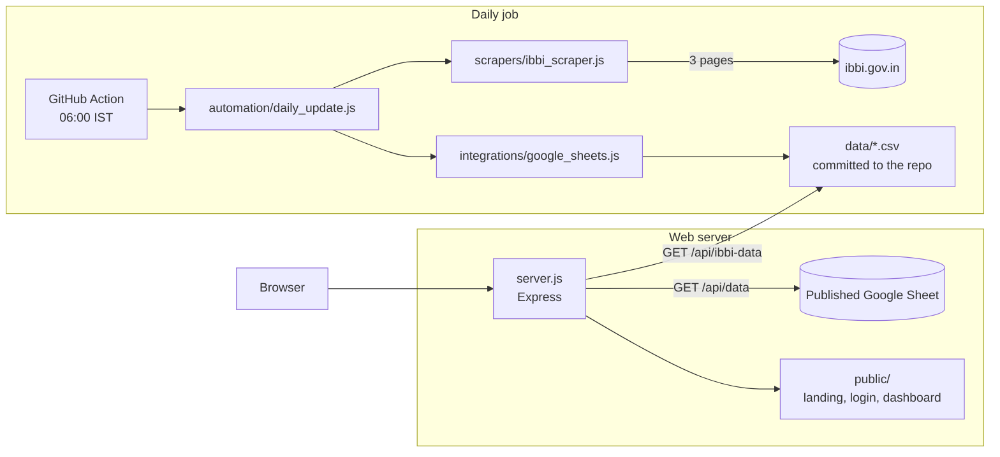

# AARSH Portal: IBBI data, scraped daily

A small portal built for AARSH Resolution Professionals, an insolvency firm. It collects three public lists from the Insolvency and Bankruptcy Board of India (IBBI) every morning and shows them in one searchable dashboard, so nobody has to check three pages by hand.



## What it does

- **Scrapes IBBI once a day.** Resolution-plan assignments with their Form G links, "what's new" announcements, and public announcements.
- **Stores the result as CSV in this repository.** A GitHub Action runs the scraper at 06:00 IST and commits `data/*.csv`, so the history of the data is the git history.
- **Serves a dashboard.** Three tabs, search, paging, a detail view for each row and CSV export.
- **Includes the firm's landing page and a demo login.**

| | |
|---|---|
|  |  |

## How it fits together



## Run it

Needs Node 18 or newer.

```bash
npm install
cp .env.example .env     # optional, see below
npm start                # http://localhost:3001
```

Open `http://localhost:3001/login.html` and sign in with the demo credentials shown on that page.

| Command | What it does |
|---|---|
| `npm start` | Start the web server |
| `npm run dev` | Start it with auto-reload |
| `npm run scrape` | Scrape IBBI now and rewrite `data/*.csv` |
| `npm run scrape:stats` | Show when the scraper last ran and how many rows it holds |
| `npm test` | Run the tests (parser and API) |

### Settings (`.env`)

| Variable | Default | Purpose |
|---|---|---|
| `PORT` | `3001` | Web server port |
| `ADMIN_TOKEN` | not set | If set, `POST /api/manual-update` requires it in an `x-admin-token` header |
| `ORIGINAL_SHEET_URL` | a published sheet | CSV source for `GET /api/data` |
| `IBBI_STRICT_TLS` | off | Set to `1` to verify IBBI's TLS certificate (see "Known limits") |

## API

| Route | Returns |
|---|---|
| `GET /api/ibbi-data` | `{ assignments, announcements, public_announcements, last_updated }` from `data/*.csv` |
| `GET /api/data` | Rows from the published Google Sheet |
| `GET /api/stats` | Last run and row counts |
| `POST /api/manual-update` | Runs the scraper now. Limited to once every five minutes; token-protected if `ADMIN_TOKEN` is set |
| `GET /api/health` | `{ ok: true }` |

## About the demo login

`public/login.html` checks a fixed email and password in the browser and remembers the result in `localStorage`. It is a front-end gate for the demo, **not authentication**: everything under `public/` and every API route is reachable without it. The summary cards at the top of the dashboard (active, liquidation, resolved) are also fixed sample numbers. A real deployment needs server-side sessions before any private data goes behind this page.

## Known limits

- **The page layouts belong to IBBI.** The parser classifies each table cell by what it contains (a date, a serial number, a name) so a reordered column does not break it, and each run logs the table headers and first row it saw. A larger redesign of ibbi.gov.in will still need a code change.
- **Certificate verification is off by default** for requests to IBBI, because the site has at times served an incomplete certificate chain that Node rejects. The data is public and read-only, but set `IBBI_STRICT_TLS=1` if the chain is healthy.
- **"Google Sheets" storage is the CSV files.** `integrations/google_sheets.js` writes to `data/` and has the hook for a real Sheets client, which is not wired up.
- **Only the newest rows are kept.** Each run replaces the CSV files with what is on the first page of each IBBI list.

## Project layout

```
server.js                    Express app and API routes
scrapers/ibbi_scraper.js     fetch and parse the three IBBI pages
automation/daily_update.js   one scrape-and-save run, with once-a-day guard and stats
integrations/google_sheets.js  CSV writer (stand-in for Sheets)
scheduler.js                 optional in-process cron, if you host the server yourself
public/                      landing page, login, dashboard
data/                        the scraped CSV files
test/                        parser and API tests
.github/workflows/scraper.yml  the daily job
```

## Stack

Node, Express, axios, cheerio, PapaParse, node-cron. Front end is plain HTML, CSS and JavaScript, with Tailwind compiled to `public/tailwind.css`.
